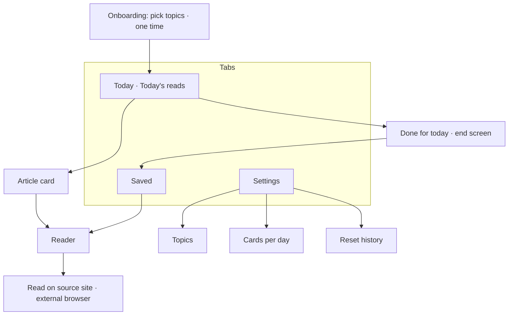
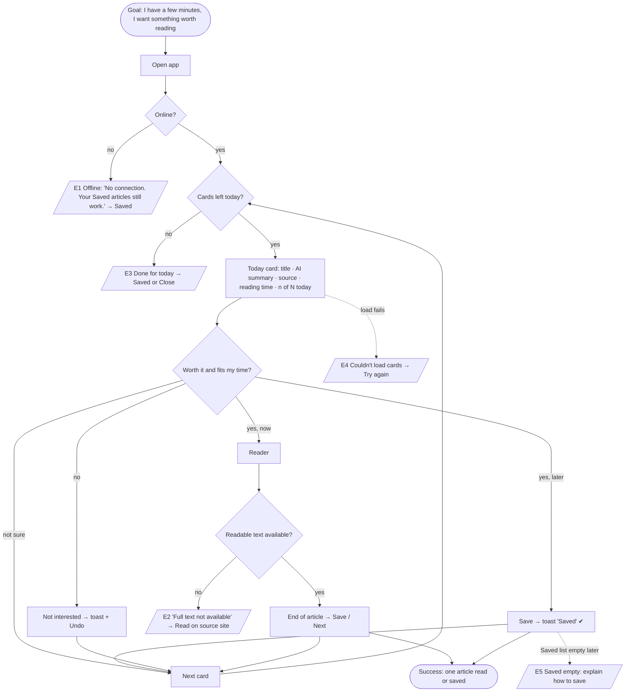

# HW05 – Information architecture and user flow

**FigJam board:** [HW05 – IA & flow](https://www.figma.com/board/W4Gs0oGtEFQ4dl8Rn5Tapv/UX-UI-2026-TechTok-Research-boards?node-id=4-530)

## What was completed

Content inventory ranked by importance, a label comprehension test with 4 (simulated) people and the resulting label changes, a sitemap, main screens and their functions, the main-task user flow with decision points and 5 exceptional states, and a note on which screens become HW06 wireframes.

**Main task (from HW04):** *In a short break, find one article worth your time and read it or save it, then finish for today.*

## Content inventory (main task only, by importance)

| Rank | Content / function | Why it's needed | Evidence |
| --- | --- | --- | --- |
| 1 | Article title | Basic "what is it" | — |
| 2 | Summary (3 sentences, labelled "AI summary") | Decide worth before opening | Insight 1 [SIM] |
| 3 | Reading time | Decide whether it fits the gap | Insight 1, P2 #8 [SIM]; audit U2 |
| 4 | Source name | Credibility / clickbait check | P4 #8 [SIM]; audit A1 |
| 5 | **Read** action | Main action | — |
| 6 | **Save** action | Keep for later | Insight 3 [SIM] |
| 7 | Progress "n of N today" | Natural end, finite | Insight 2 [SIM] |
| 8 | Next card (swipe + button) | Move on; accessible alternative | Audit U5/A2 |
| 9 | Not interested | Remove bad cards | — |
| 10 | Read on source site | Original, copyright | Brief |
| 11 | Cover image (optional) | Recognition, not essential | [A] |
| 12 | End-of-day message + path to Saved | Finish, alternative to "more" | Insight 2, 3 |

**Left out of the main task:** settings details, topic onboarding (kept only as a one-time entry step), similar articles, sharing, search. There is no search on purpose: the product is a finite set, not a library.

## Label check (4 people, comprehension test) [SIM]

Method: each label was shown alone, without context, and the participant said what they'd expect. Full answers are in [notes-SIM-P1-P4.md](../../project/docs/research/notes-SIM-P1-P4.md#label-check-hw05).

| Label | Understood | Problem seen | Change |
| --- | --- | --- | --- |
| Today | 2 ✔ · 1 partly · 1 ✘ | P2 read it as a calendar | Keep **Today** as the tab (it signals finite). The screen title is "**Today's reads**". "Feed" was preferred by 2 people, but it suggests an endless feed, which contradicts the core principle. |
| Saved | 4 ✔ | — | Keep (3 of 4 picked it over the alternatives) |
| Not interested | 2 ✔ · 2 partly | Unclear scope (this article? the topic? the source?) | Keep the label. Add feedback: toast "**Hidden. You'll see fewer like this.** Undo" |
| Daily limit | 1 ✔ · 3 partly | Read as *screen time* | Rename to "**Cards per day**" |
| Topics | 4 ✔ | — | Keep |
| AI summary | 4 ✔ | Doubt about accuracy (P3) | Keep, plus "Read on [source]" next to it as the check |
| Open original | 3 ✔ · 1 ✘ | "Original… photo?" | Rename to "**Read on [source name]**" |
| 12 of 30 | 2 ✔ · 2 ✘ | Read as a page number or "left" | Change to "**12 of 30 today**". **Retest in HW07/HW08.** |
| Done for today | 4 ✔ | — | Keep |

**Lessons:** labels that name a *thing* (Saved, Topics) work. Labels that name a *rule* (Daily limit, 12 of 30) need the unit and the time frame spelled out.

## Sitemap

## Main screens and functions

| Screen | Functions |
| --- | --- |
| **Today** (card) | See title, AI summary, source, reading time, progress; Read; Save; Not interested; Next |
| **Reader** | Read clean text; Save; Read on source; Back to Today (continues at the next card) |
| **Done for today** | Message that the set is finished and when the next set arrives; Go to Saved; Close |
| **Saved** | List with reading time; open in Reader; mark read; remove; works offline |
| **Settings** | Topics, Cards per day, Reset history |

## User flow: main task

Starts from the user's goal, not from the app icon.

**Exceptional states (each tied to a real risk):** E1 Offline (students on trams lose signal [A]) · E2 Extraction failed (the extraction step can fail on some blogs: project plan) · E3 Set finished (by design, and the most important one: it must not feel like an error) · E4 Load error · E5 Saved empty.

## Wireframes for HW06

1. **Today card**: the main and decision screen. Mobile + large screen.
2. **Reader**.
3. **Today card + "Saved" toast**: the confirmation.
4. **Done for today** (E3): the end of the task.
5. **Critical states:** E1 Offline and E2 Full text not available.
